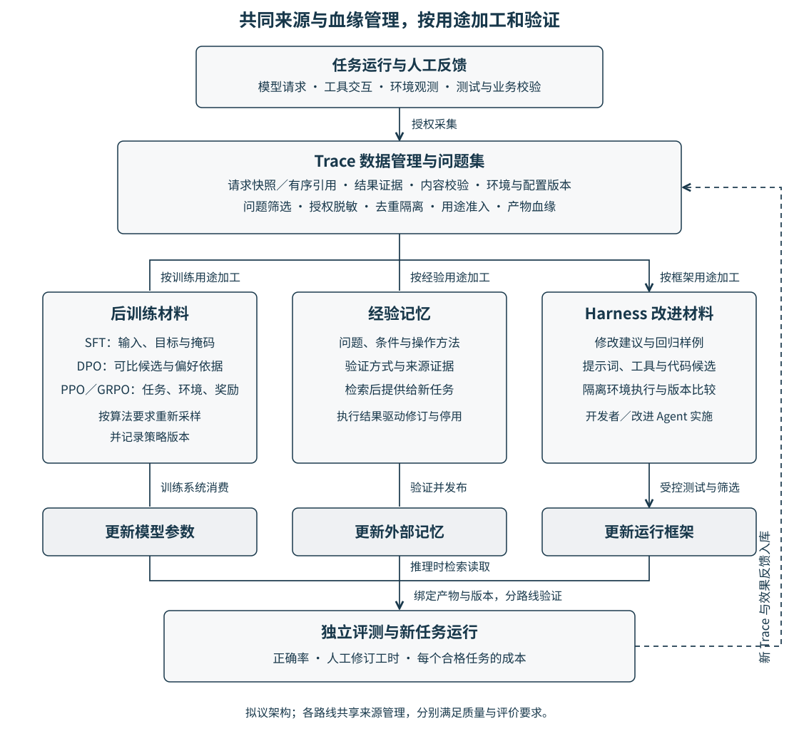

# 面向 Agent 持续改进的 Trace 数据管理

## 摘要

智能体（Agent）的执行记录（Trace）关联模型调用、工具交互与环境反馈，可用于识别问题，以及生成训练样本、经验记忆和运行框架改进材料。本方案提出按用途判定数据可用性、保留证据与版本关联的数据服务，以企业经营分析为试点，验证其对任务质量、人工复核和推理费用的影响。

## 1. Background：背景

Agent 的改进可以更新模型参数、外部记忆，或由提示词、工具和控制流程组成的运行框架（harness）。Agent Lightning 等框架已支持将运行交互转为训练数据，也提供 Agent 优化流程。[1] 本方案拟补充的机制是：同一执行记录按用途分别准入，将缺失证据对应到具体用途，并关联来源、加工版本、改进产物与后续评价。其差异通过错误数据检出率、加工工时和任务效果比较验证。

## 2. Problem：场景与问题

企业经营分析 Agent 查询订单、退款和费用，解释区域利润变化。分析师发现一对多关联导致金额重复汇总，修正查询语句并完成对账。这些记录既包含正确操作，也包含经验适用条件和框架检查需求。

利用这些材料面临三项问题：增量日志缺少完整请求或工具定义；成功标记与业务正确性缺乏核验；不同路线各自加工，难以追溯来源与判断改进效果。敏感信息还需要按授权用途控制。

## 3. 方案描述

### 3.1 管理来源证据、用途状态与存储

关联任务、模型请求与响应、工具定义、环境版本及校验结果。上下文保存为快照或精确有序引用，以顺序号、内容哈希检查缺失与错配。每条记录保存各用途的准入状态、理由及转换版本；例如，缺少原请求证据的发布轨迹可按约定配方构造样本，但须拒绝“精确复现原请求”的用途。

存储选择依据对象大小与数量、压缩率、读取频率及引擎特征：任务检索先读结构化索引，详情与高频上下文优先测试库内布局，低频大对象比较外置方案；按写入开销、详情延迟、批量吞吐和总空间选型。引用与对象内容通过哈希核对，跨存储写入失败进入补偿处理。[4]

### 3.2 后训练：交付满足算法要求的材料

监督微调（SFT）按决策构造输入、目标与监督掩码，检查工具协议及分词保真。直接偏好优化（DPO）使用同一任务、相同输入上下文下的候选对，并保存排序依据。近端策略优化（PPO）、组相对策略优化（GRPO）按算法要求由当前策略重新采样；历史记录提供任务、环境和奖励依据，新采样记录保存策略版本、奖励及所需概率信息。训练系统消费材料并更新参数。[5–7]

### 3.3 经验记忆：在新任务中检索使用

提取“问题、适用条件、方法、验证方式、来源证据”，经测试或人工确认形成经验。新任务按问题与环境检索，将经验作为上下文交给 Agent；查询方法复用，结果按当前数据重算。使用反馈驱动修订和停用。该路线更新外部记忆。

### 3.4 运行框架：验证修改候选

比较同模型、同预算的执行记录，提出工具反馈、上下文管理或结果校验的修改建议，形成回归样例。开发者或改进 Agent 在隔离环境修改提示词、工具及代码，以独立任务测试候选。该路线更新框架。三条路线的产物均绑定来源与版本，新运行结果继续入库。

*图 1：按用途加工数据，分别更新模型参数、外部记忆和运行框架，再以独立任务检验效果。*

## 4. 落地与商业价值

### 4.1 前置实验基础

交互推理基准 ARC-AGI-3 的 5 个游戏各做 3 轮辅助开关对照，模型相同、每轮上限 1,000 动作。开启 11 项观测与记忆辅助后，相对人类动作效率分数（兼顾过关与动作效率，0–100 分）均值从 12.7 升至 33.4，15 对中 13 对提高；结果属于辅助组合，单项贡献待验证。[2]

两个公开编程轨迹集各取 8 条，比较直接生成监督样本与经仿 OpenTelemetry（观测数据标准）记录重建后生成样本的路径，16 条的语义、分词编号与监督标签一致。该实验未经过真实摄入链路，也未训练模型。[3]

### 4.2 试点、目标与边界

首期采用一个授权、脱敏的只读经营数据库快照，覆盖指标查询、关联汇总、异常解释三类任务，共 90 项：30 项开发、60 项封存评测，按任务与时间去重隔离。开发集构建训练样本、经验和回归集；先验证 SFT、DPO 的数据交付，PPO／GRPO 仅测试采样与奖励记录适配。

开发集选定发布候选后，与固定基线在同一封存集各重复 3 次。预设验收目标为：任务正确率提高至少 5 个百分点、人工复核工时下降至少 20%、每个正确任务的推理费用不增加、产物来源可追溯率 100%。正确须同时通过执行、数值对账和业务口径核验；报告按任务聚合的配对置信区间。以上均为待验证门槛，定义与统计方法见附录。[8]

风险包括隐私泄露、评价泄漏、错误经验传播、奖励投机与环境漂移。实施授权过滤、评测集封存、证据核验、经验失效和版本回退；修改限定在隔离环境。首期覆盖只读分析，业务写操作及长期训练收益另行验收。

服务面向 Agent 平台、企业经营分析产品和行业模型团队，可按托管数据量与加工任务提供私有化部署服务，验证数据加工工时、重复错误及任务成本的改善。

## 参考来源

1. [Agent Lightning v1.0 与 Agent 优化流程](https://github.com/microsoft/agent-lightning/tree/2070bad5113e52f1aa2e5bdba822d4b24b197c05)：官方 README 和 skills/README，访问于 2026-11-13。
2. [观测与记忆辅助对照：条件、计分和限制](实验证据与验收口径.md#实验一观测与记忆辅助对照)。
3. [离线监督样本转换：输入、双路径和限制](实验证据与验收口径.md#实验二离线监督样本转换)。
4. [存储布局：实测发现与选型依据](实验证据与验收口径.md#实验三长载荷存储布局)。
5. [Direct Preference Optimization: Your Language Model is Secretly a Reward Model](https://arxiv.org/abs/2305.18290)，2023。
6. [Proximal Policy Optimization Algorithms](https://arxiv.org/abs/1707.06347)，2017。
7. [DeepSeekMath: Pushing the Limits of Mathematical Reasoning in Open Language Models](https://arxiv.org/abs/2402.03300)，2024。
8. [试点设计、验收指标、差异比较与风险控制](实验证据与验收口径.md#试点设计与验收口径)。
