# Agent Trace：数据管理与应用

记录形态、存储管理与 VISTA 实例

曹金羽 · Agent Trace 组 · 2026-11-09

本文对应 2026-11-09 版 26 页幻灯片。正文保留页面内容，表格与图表数据转为 Markdown 表格；各节附 PDF 原页预览。动图和视频以静态画面呈现，动态演示见 PPTX。榜单和实验数字沿用该版快照。

[PPTX](Agent-Trace-部门分享-v5.pptx) · [PDF](Agent-Trace-部门分享-v5.pdf) · [逐页提词](逐页提词.md)

### 目录

- [01 · Agent Trace：数据管理与应用](#slide-01)
- [02 · Trace 回顾：span 树与时间轴](#slide-02)
- [03 · 同一次测试失败，在四种记录中的样子](#slide-03)
- [04 · 对话文本、Trace、State 与 Memory：内容与格式](#slide-04)
- [05 · 重叠、互斥与转化：运行时组装与事后派生](#slide-05)
- [06 · Trace 存什么：按 GenAI 约定存储的 span](#slide-06)
- [07 · Trace 怎么存：字段特性决定存法](#slide-07)
- [08 · 三个引擎：与实验相关的存储特性](#slide-08)
- [09 · ClickHouse：part 与 merge、JSON 子列](#slide-09)
- [10 · JSON 表示实验：按查询形态选择表示](#slide-10)
- [11 · 长载荷布局实验：四种布局](#slide-11)
- [12 · 长载荷布局实验：各场景的推荐布局](#slide-12)
- [13 · 选型推论：按引擎与访问需求](#slide-13)
- [14 · ARC-AGI-3：定位、规模与计分](#slide-14)
- [15 · ARC-AGI-3 得分：官方榜单与 harness](#slide-15)
- [16 · VISTA：无损视觉记录与 8 个工具](#slide-16)
- [17 · 上下文会压缩，历史和笔记继续保留](#slide-17)
- [18 · VISTA 的三层：上游能力、trace 接入、经验辅助](#slide-18)
- [19 · VISTA Trace 版：写入与读取路径](#slide-19)
- [20 · 读屏障与恢复：从已确认的记录继续](#slide-20)
- [21 · 11 项 aids：把执行历史整理成决策提示](#slide-21)
- [22 · tu93：同局历史进入下一次决策](#slide-22)
- [23 · 经验辅助的提升：过关、效率与跨关复用](#slide-23)
- [24 · Luna：完整框架与经验辅助的整体效果](#slide-24)
- [25 · Trace：是什么、存什么、怎么存、怎么用](#slide-25)
- [26 · 谢谢](#slide-26)

<a id="slide-01"></a>

## 01 · Agent Trace：数据管理与应用

部门技术分享

记录形态、存储管理与 VISTA 实例

- 记录形态
- 存储管理
- VISTA 应用

曹金羽 · Agent Trace 组 · 2026-11-09

<details>
<summary>第 01 页原页预览</summary>

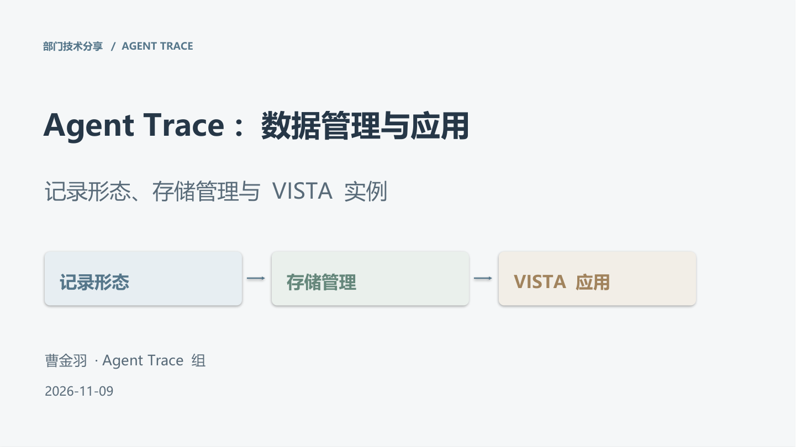

</details>

来源：[S01](#source-s01)、[S11](#source-s11)。

<a id="slide-02"></a>

## 02 · Trace 回顾：span 树与时间轴

01 · 记录形态

span 按父子层级缩进；时间轴以开始时间和持续时间表示。◆ 表示 span 内事件，ERROR 表示执行失败。

| 层级 | 类型 | 操作 | 开始（秒） | 持续（秒） | 状态 | 结果与内容 | span 内事件时间（秒） |
| --- | --- | --- | --- | --- | --- | --- | --- |
| L0 | agent | 修复测试 fix-42 | 0 | 100 | OK | 任务通过（任务层验证） | — |
| L1 | LLM | chat：分析失败 | 0 | 8 | OK | 输入 / 输出 tokens | — |
| L1 | retriever | 检索相关经验 | 8 | 5 | OK | 命中 1 条 memory | — |
| L1 | agent | 子 agent：复现问题 | 14 | 31 | OK | 独立子任务 | — |
| L2 | LLM | chat：制定复现步骤 | 14 | 7 | OK | 测试命令 | — |
| L2 | tool | run_tests | 22 | 21 | ERROR | ERROR · exit 1 | 43 |
| L1 | LLM | chat：生成修改 | 47 | 10 | OK | 修改依据与输出 | — |
| L1 | guardrail | 检查修改范围 | 57 | 3 | OK | 通过 | — |
| L1 | tool | edit_file date.py | 60 | 9 | OK | 文件与 diff | — |
| L1 | tool | run_tests（重测） | 70 | 20 | OK | OK · exit 0 | — |
| L1 | evaluator | 评估测试结果 | 91 | 9 | OK | 通过 | — |

<details>
<summary>第 02 页原页预览</summary>

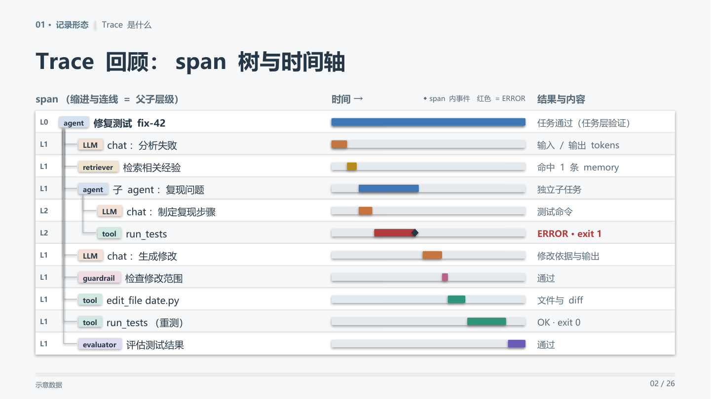

</details>

来源：[S01](#source-s01)、[S07](#source-s07)。

<a id="slide-03"></a>

## 03 · 同一次测试失败，在四种记录中的样子

01 · 记录形态

### 对话文本

消息数组 · Chat Completions 格式

```text
[
 {"role": "user",
  "content": "test_parse_date 一直失败，帮我修一下"},
 {"role": "assistant",
  "content": "先运行这个测试，确认失败信息。",
  "tool_calls": [{"id": "call_7",
    "function": {"name": "run_tests",
                 "arguments": "{\"k\": \"parse_date\"}"}}]},
 {"role": "tool", "tool_call_id": "call_7",
  "content": "1 failed: test_parse_date (exit 1)"}
]
```

### Trace

span 树 · 按 parent_span_id 组装后的视图

```text
{"trace_id": "4bf92f35…", "span_id": "7d00",
 "name": "invoke_agent fixer",
 "time": "+0.0s → +100.0s", "status": "OK",
 "children": [
  {"span_id": "7d01", "name": "chat model-a",
   "attributes": {
     "gen_ai.usage.input_tokens": 3120}},
  {"span_id": "7d02",
   "name": "invoke_agent reproducer",
   "time": "+14.0s → +45.0s",
   "children": [
    {"span_id": "a3c1",
     "name": "execute_tool run_tests",
     "time": "+22.0s → +43.1s",
     "status": {"code": "ERROR", "message": "1 failed"},
     "attributes": {
       "gen_ai.tool.call.id": "call_7",
       "process.exit.code": 1},
     "events": [{"name": "exception",
                 "time": "+43.0s"}]}]},
  {"…": "检索、生成修改、检查、编辑等 5 个 span"},
  {"span_id": "7d09",
   "name": "execute_tool run_tests",
   "status": "OK"}]}
```

### State

checkpoint 快照 · LangGraph 形式，字段有简化

```text
{"thread_id": "fix-42", "step": 6, "next": ["edit_file"],
 "values": {"failing": ["test_parse_date"], "edited": []}}
{"thread_id": "fix-42", "step": 9, "next": [],
 "values": {"failing": [], "edited": ["date.py"]}}
```

### Memory

经验条目 · 纯文本，带来源

```text
1. parse_date 相关测试失败时，先检查测试是否固定了 TZ。
   来源：span a3c1 · 版本 1
2. 本仓库运行单个测试：pytest -k <名称>。
3. 改动 date.py 后，同时重跑 test_parse_date 与 test_format_date。
```

<details>
<summary>第 03 页原页预览</summary>

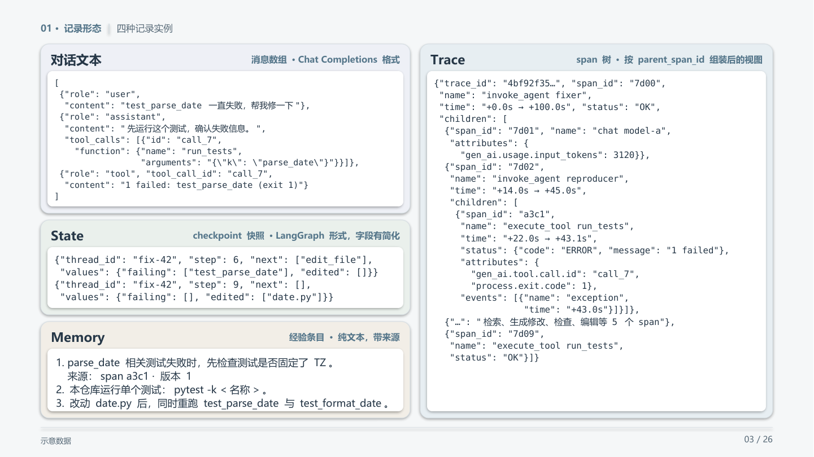

</details>

来源：[S28](#source-s28)、[S30](#source-s30)、[S31](#source-s31)。

<a id="slide-04"></a>

## 04 · 对话文本、Trace、State 与 Memory：内容与格式

01 · 记录形态

|  | 对话文本 | Trace | State | Memory |
| --- | --- | --- | --- | --- |
| 记录对象 | 本次发给模型的<br>消息与工具结果 | 每次操作、关系<br>与结果 | 当前进度、变量<br>与待办 | 跨任务复用的<br>规则、事实与偏好 |
| 典型格式 | 消息数组<br>role · content | span 树<br>ID · 父关系 · 时间 | 快照或键值<br>按线程与步骤保存 | 条目 + 来源<br>按命名空间检索 |
| 写入方式 | 追加；可裁剪、<br>压缩、改写 | 只追加 | 覆盖当前值<br>或新增快照 | 提炼、修订、撤回 |
| 时间范围 | 一次调用的窗口 | 整个执行过程 | 某一时刻 | 跨会话、跨任务 |
| 主要读取方 | 模型、用户 | 开发、评估、<br>归因、审计 | 框架：继续、<br>恢复执行 | 后续任务中的模型 |
| DB 类比 | 一次查询的结果集 | 日志 / WAL | 数据页 / 调用栈 | 物化视图 / 索引 |

<details>
<summary>第 04 页原页预览</summary>

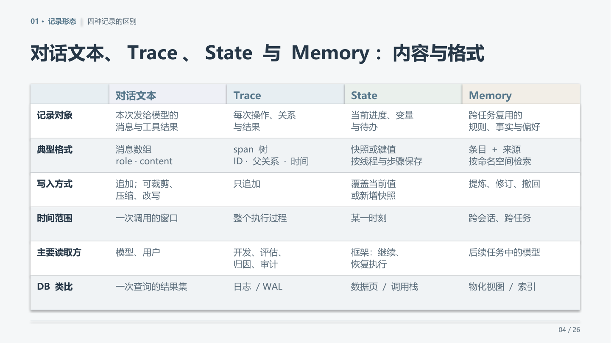

</details>

来源：[S01](#source-s01)、[S17](#source-s17)、[S28](#source-s28)、[S29](#source-s29)。

<a id="slide-05"></a>

## 05 · 重叠、互斥与转化：运行时组装与事后派生

01 · 记录形态

| 记录 | 内容 |
| --- | --- |
| State | 当前值 / checkpoint |
| 对话文本 | 本次调用的模型输入 |
| Memory | 派生条目，带来源 |
| Trace | 模型调用、工具执行与状态写入，逐步追加为 span；不进入模型输入 |

### 运行时与事后派生

- State 组装、Memory 检索和当前观测共同构成本次调用的模型输入。
- 执行后更新 State，每步追加 span 到 Trace。
- Trace 可用于重放状态、还原当次输入，以及提炼带来源的 Memory。

重放：状态写入全部有记录、顺序确定，外部环境确定。提炼：保留来源 span 与版本。还原：保存了完整输入，或可按裁剪规则重建。

### 重叠

第 3 页 call_7 的结果同时出现在对话文本的 tool 消息、trace 的 span 和 memory 的来源中。

### 只在一处

span 关系、时延、重试、被裁剪的旧消息、state 覆盖前的旧值只在 trace 中；memory 的归纳结论在 trace 中没有逐字原文。

### 还原输入的代价

同批 Open-SWE 样本：每次调用存完整上下文，比只存新增消息大 53.15 倍；增量存储需按裁剪规则重建。

<details>
<summary>第 05 页原页预览</summary>

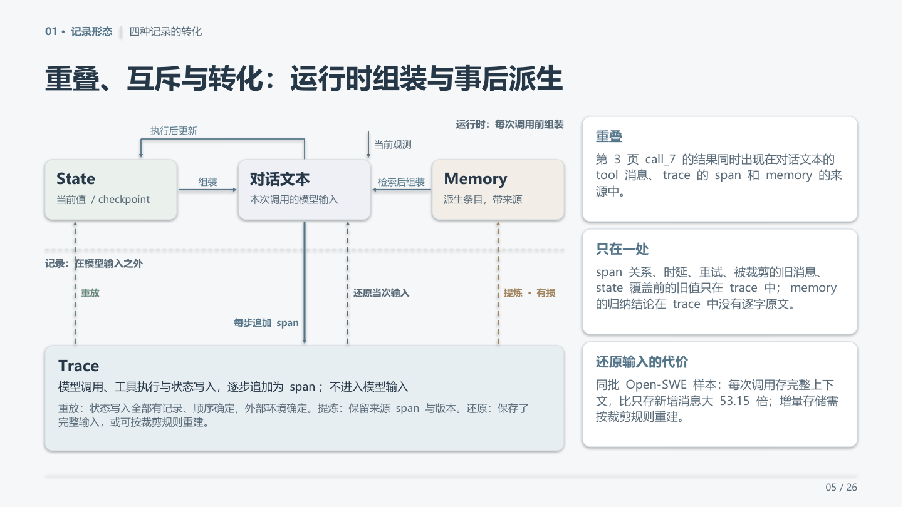

</details>

来源：[S08](#source-s08)、[S28](#source-s28)。

<a id="slide-06"></a>

## 06 · Trace 存什么：按 GenAI 约定存储的 span

02 · 存储与管理

### 一条 span 的存储形态（每个 span 一条记录）

```json
{"trace_id": "4bf92f35…",
 "span_id": "7d01", "parent_span_id": "7d00",
 "name": "chat model-a",
 "start_time": "+0.0s", "end_time": "+8.0s",
 "status": {"code": "OK"}, "kind": "CLIENT",
 "attributes": {
   "gen_ai.operation.name": "chat",
   "gen_ai.request.model": "model-a",
   "gen_ai.usage.input_tokens": 3120,
   "gen_ai.input.messages": [
     {"role": "user",
      "parts": [{"type": "text",
                 "content": "帮我修复失败测试"}]}]},
 "resource": {"service.name": "fixer-agent"},
 "events": [], "links": []}
```

user 消息属于右侧④。模型调用有输入；把消息正文写入 Trace 需显式开启。工具等其他 span 可不含消息。

| 字段组 | 必有性与体积 | 字段 | 用途 |
| --- | --- | --- | --- |
| ① 结构与时间 | 必有 | trace_id · span_id · parent_span_id（根 span 无）· name · 起止时间 | 归组、标识、连成树、排出时间轴；缺一项则树或时间轴无法拼出 |
| ② 结果与类型 | 有默认值 | status（默认 Unset）· span kind（默认 INTERNAL）· gen_ai.operation.name | 筛选失败；区分模型调用、工具执行与 agent |
| ③ 上下文与度量 | 可选，体积小 | resource · 运行 ID · 模型、工具、agent 名 · token 用量 · 配置版本 | 比较配置、统计成本、跨 trace 关联 |
| ④ 内容与关联 | 可选，体积大或稀疏 | 输入输出消息 · 工具参数与结果 · 文件与截图 · events · links · 评分 · 采集标记（采样、截断、脱敏） | 复现决策、审计、评估与训练；内容在约定中默认不采集 |

<details>
<summary>第 06 页原页预览</summary>

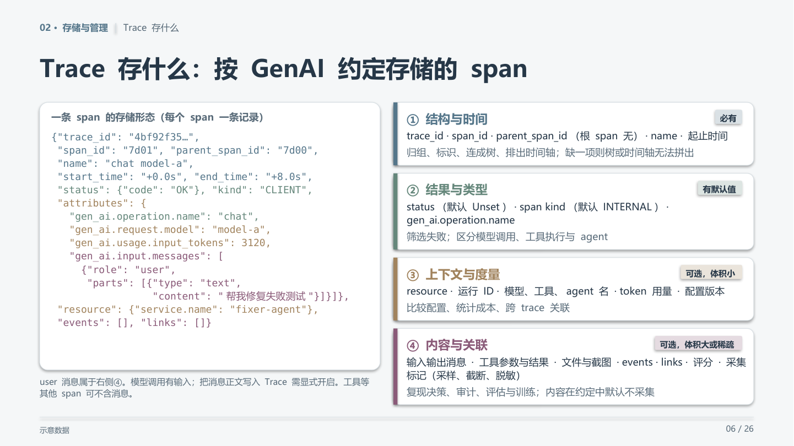

</details>

来源：[S01](#source-s01)、[S31](#source-s31)。

<a id="slide-07"></a>

## 07 · Trace 怎么存：字段特性决定存法

02 · 存储与管理

| 字段组 | 必有性 | 体积与取值 | 写后变化 | 主要读取 | 常见存法 |
| --- | --- | --- | --- | --- | --- |
| 结构与时间 | 必有 | 定长 ID、时间戳 | 写后不变<br>可能重复、乱序<br>或缺父 span | 按 trace_id 取树<br>按时间范围扫描 | 普通列；ID / 时间<br>作排序或分区键<br>parent 不设外键 |
| 结果与类型 | 有默认值 | 枚举，低基数 | span 结束时确定 | 过滤失败<br>按类型聚合 | 普通列或字典编码 |
| 上下文<br>与度量 | 可选 | 值小，键集合<br>随工具、模型增加 | 写后不变 | 看板过滤与聚合 | 常用键提为普通列<br>其余用 JSON / 子列<br>表示实验见第 10 页 |
| 反馈与派生 | 可选<br>晚到 | 值小，可带版本 | 运行后追加或修订 | 评估、选样 | 独立表，带版本<br>按 trace / span ID 关联 |
| 内容 | 可选<br>显式开启 | 单条消息中位 130 B<br>累积输入中位 98 KB | 写后不变<br>脱敏或到期删除 | 列表不读；详情按 ID<br>回放、导出批量读 | 布局见第 11 页<br>长载荷实验 |

<details>
<summary>第 07 页原页预览</summary>

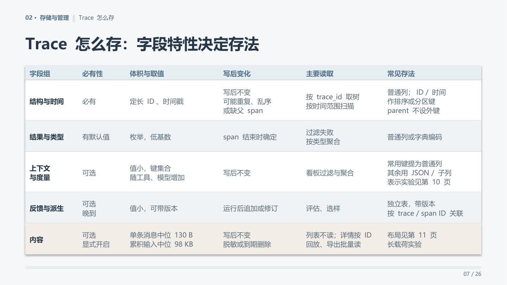

</details>

来源：[S08](#source-s08)、[S31](#source-s31)。

<a id="slide-08"></a>

## 08 · 三个引擎：与实验相关的存储特性

02 · 存储与管理

| 特性 | openGauss（行存 · x86） | XStore（行存 · ARM） | ClickHouse（列存 · x86 / ARM） |
| --- | --- | --- | --- |
| 存储模型 | PG 系 heap 页，一行为一个 tuple | GaussDB 系 heap 页<br>SQL 与 openGauss 同源 | MergeTree：写入生成 part<br>后台 merge 合并（见下页） |
| 大字段 | 超过约 2 KiB 时压缩另存<br>主行只留 TOAST 指针 | 不使用 TOAST<br>大字段不压缩，留在主表 heap | 按列存放并压缩<br>查询只读用到的列 |
| JSON | JSON 存文本<br>JSONB 存二进制文档 | 本轮未测 | JSON 类型按路径拆成子列<br>机制见下页 |
| 实验涉及 | B-tree 索引<br>表达式索引与 GIN 索引 | 空字符串按 NULL 处理<br>不支持 FILTER 聚合<br>分页游标需补时间下界 | part 数影响查询速度<br>无行级更新，改用 mutation<br>JOIN 先读整张右表 |

<details>
<summary>第 08 页原页预览</summary>

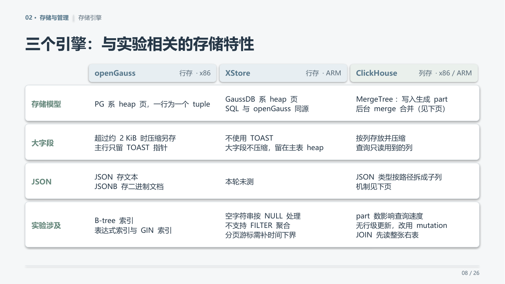

</details>

来源：[S10](#source-s10)、[S09](#source-s09)。

<a id="slide-09"></a>

## 09 · ClickHouse：part 与 merge、JSON 子列

02 · 存储与管理

### MergeTree：part 与后台 merge

```text
part 1 + part 2 + part 3 + … → 后台 merge → 新 part（重写列数据与索引）
```

- 每次 INSERT 生成一个不可变的 part，各列分别压缩存放
- merge 把相邻小 part 合成新 part，再原子替换旧 part
- 查询逐个打开 part，part 越多定位开销越大
- 没有行级更新，改一行要用 mutation 重写所在 part

### JSON 类型：按路径拆成子列

attributes（JSON 列）

| 组织形式 | 特性 |
| --- | --- |
| type hint | 建表时<br>声明类型 |
| 动态子列 | 自动建列<br>每 part ≤ 32 条 |
| 共享区 | 超出上限<br>多路径合存 |

- 按路径查询只读对应子列，不解析整段文本
- 每个 part 各自分配路径，merge 时按非空值数重选
- 返回完整文档要汇集全部子列再重组
- 子列与路径元数据增加写入工作和空间

<details>
<summary>第 09 页原页预览</summary>

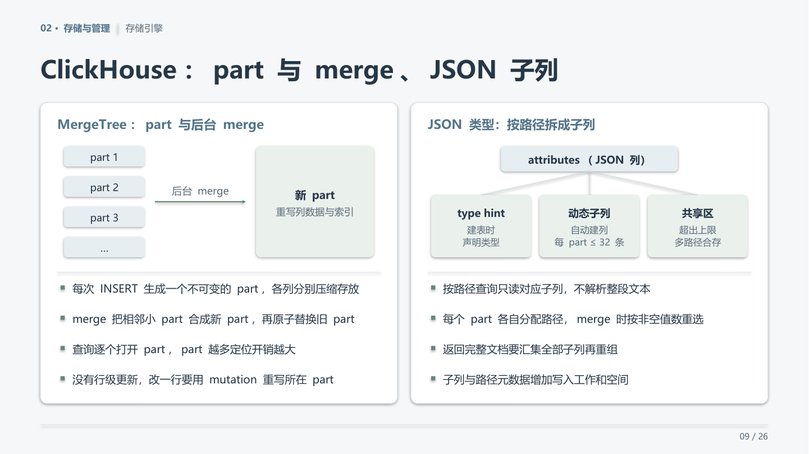

</details>

来源：[S09](#source-s09)、[S10](#source-s10)。

<a id="slide-10"></a>

## 10 · JSON 表示实验：按查询形态选择表示

02 · 存储与管理

| 表示 | 存储与读取 |
| --- | --- |
| PG JSON | 文本存储；读取路径时解析 |
| PG JSONB | 写入时解析；按二进制结构定位 |
| ClickHouse JSON | 同名路径跨行组织为子列（第 9 页） |

### 同一输入：JSON 保存原文，JSONB 保存解析后的文档结构

```json
{"b": 2, "a": 1, "b": 3}
```

JSON：校验语法，保留空格、键顺序与重复键；<br>按路径取值时重新解析文本。

JSONB：识别对象与数值 → 键排序、重复键保留末值<br>逻辑结果为 {"a": 1, "b": 3}，再序列化为连续字节。

```text
[总长度][对象头：2 对][JEntry × 4][数据区]
```

JEntry：类型 + 结束位置；数据区：a、Numeric(1)、b、Numeric(3)

openGauss 6.0 结构示意；嵌套对象递归存放，数组保留顺序。

### 实验设置

openGauss JSON 与 JSONB · ClickHouse String 与 JSON · 同一 x86 主机 · 48,534 个 span · 按 truth 核对 · 三轮 p50

| 查询场景 | 结论 | 比较项目 | 表示一 | 结果一 | 表示二（更优） | 结果二 |
| --- | --- | --- | --- | --- | --- | --- |
| 写入与空间 | 文本更省 | ClickHouse 总空间 | JSON 类型 | 54 MiB | String | 33 MiB |
| 路径过滤与聚合 | 结构化快 3–12 倍 | ClickHouse 高密度过滤 | String | 81 ms | JSON 类型 | 9.9 ms |
| 返回完整文档 | 文本更快 | openGauss 带总数分页 | JSONB | 458 ms | JSON | 193 ms |

<details>
<summary>第 10 页原页预览</summary>

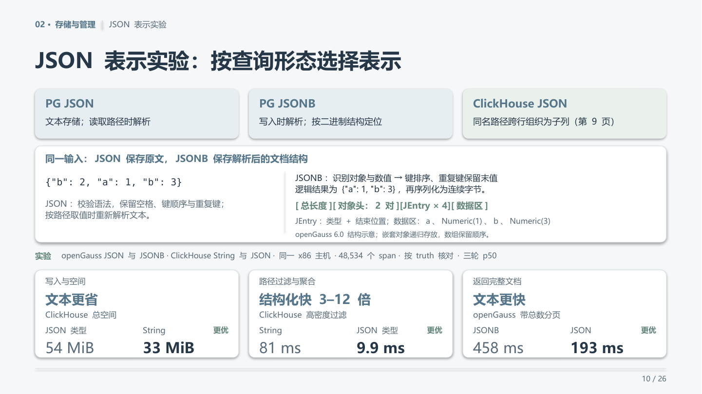

</details>

来源：[S09](#source-s09)、[S08](#source-s08)、[S35](#source-s35)。

<a id="slide-11"></a>

## 11 · 长载荷布局实验：四种布局

02 · 存储与管理

| 布局 | 库内表或库外文件 | 访问方式 |
| --- | --- | --- |
| same_table | events：普通列 + 载荷（库内表） | 列表与详情<br>都读同一张表 |
| separate | events_analytics：普通列（库内表）<br>event_payloads：event_id + 载荷（库内表） | 详情与 Trace<br>按 event_id 连接两表 |
| full_core | events_full：普通列 + 载荷（库内表）<br>events_core：普通列副本（库内表） | 写入时双写<br>列表读副本，详情读完整表 |
| asset_ref | events_analytics：普通列 + asset_id（库内表）<br>assets：每个对象一行：状态与校验值（库内表）<br>对象文件：库外，按内容寻址（库外文件） | 库内两张表<br>读取时核对目录与文件 |

| 图例 | 含义 |
| --- | --- |
| payload | 含载荷的表 |
| plain | 不含载荷的表 |
| file | 库外文件（虚线以下） |

| 实验项 | 设置 |
| --- | --- |
| 载荷 | 160 条，占 0.33% 的行 · 三档 64 KiB / 512 KiB / 2 MiB · 等总字节对照 80 MiB = 40 × 2 MiB 或 1,280 × 64 KiB |
| 场景 | 写入与空间 · 列表与预览 · 单条详情与完整 Trace · 批量恢复 · 并发 · ClickHouse part 状态 |
| 核对 | 四种布局返回相同的行与载荷字节 · 逐条核对 SHA-256 · 四轮 p50 |

<details>
<summary>第 11 页原页预览</summary>

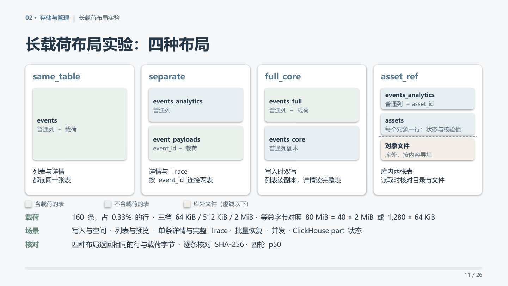

</details>

来源：[S10](#source-s10)。

<a id="slide-12"></a>

## 12 · 长载荷布局实验：各场景的推荐布局

02 · 存储与管理

| 场景 | openGauss | XStore | ClickHouse |
| --- | --- | --- | --- |
| 写入 | same_table | same_table | same_table |
| 总空间 | same_table | asset_ref | same_table |
| 列表与预览 | 四种相同 | 避开 same_table | same_table |
| 详情与 Trace | 库内布局 | 库内布局 | 避开 separate |
| 大对象批量恢复 | asset_ref | asset_ref | asset_ref |
| 小对象批量恢复 | 库内布局 | 库内布局 | 库内布局 |

### 外置后的总空间

| 项目 | 结果 |
| --- | --- |
| openGauss | 2.88 倍 |
| XStore | 0.79 倍 |
| ClickHouse | 6.92 倍 |

asset_ref 相对 same_table

### 批量恢复 80 MiB

| 项目 | 结果 |
| --- | --- |
| 40 × 2 MiB | 外置最快 |
| 1,280 × 64 KiB | 外置最慢 |

取决于对象数，与总字节无关

ClickHouse 的 part 状态对列表的影响约为布局差异的 3 倍，先控制 part 数

<details>
<summary>第 12 页原页预览</summary>

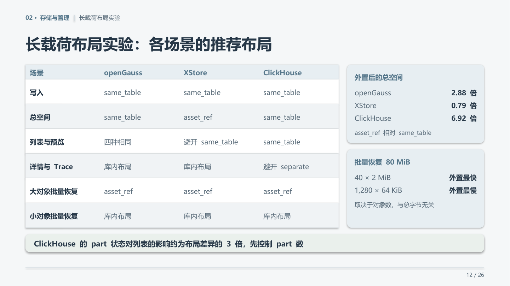

</details>

来源：[S10](#source-s10)。

<a id="slide-13"></a>

## 13 · 选型推论：按引擎与访问需求

02 · 存储与管理

| 引擎 | 长载荷布局 | 动态属性 | 维护 |
| --- | --- | --- | --- |
| openGauss | same_table | JSONB | 列表与 Trace 复合 B-tree |
| XStore | full_core | 待测 | 分页游标补时间下界 |
| ClickHouse | same_table<br>分层时用 full_core | JSON 类型 | 控制 part 数 |

### 看板与列表为主

列存 + 库内布局

例如 Langfuse 另建列表表

### 运行中读回刚写入的历史

行存 + 库内布局

例如第 20 页的 VISTA

### 频繁导出 MiB 级对象

外置引用

读取时核对对象字节

建表之前先定记录约定：完整上下文与增量相差 53 倍 · 签名与精确重放另存原文 bytes

<details>
<summary>第 13 页原页预览</summary>

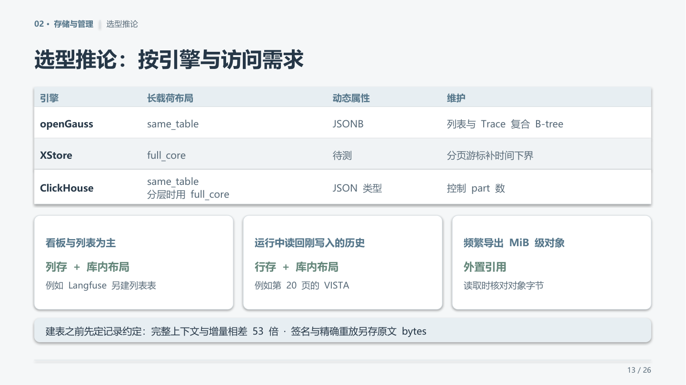

</details>

来源：[S08](#source-s08)、[S10](#source-s10)、[S07](#source-s07)、[S04](#source-s04)。

<a id="slide-14"></a>

## 14 · ARC-AGI-3：定位、规模与计分

03 · VISTA 实例

VISTA 原始多场景动图；放映时播放

### 游戏形态

64×64 网格、16 色画面；按键、撤销与点击动作。不给规则与目标，需要探索、推断胜利条件，并把规律迁移到后续关卡。人类可解全部环境。

### 定位

ARC Prize 推出的第三代 ARC-AGI，官方定位为首个交互式推理 benchmark；衡量在陌生环境中探索、建模和持续学习的效率。2026 年 3 月发布时前沿模型均低于 1%。

### 规模与竞赛

公开 25 个游戏、183 关；半私有、完全私有各 55 个。ARC Prize 2026 设 ARC-AGI-3 赛道，经 Kaggle 离线评测，总奖金 85 万美元，大奖要求 100% 并开源。

### 计分：RHAE

游戏与关卡难度不同，以首次游玩者的动作数为基线，衡量过关与动作效率；只计改变环境的动作，后续关卡权重更高，各游戏等权汇总。

### 官方测试

官方榜单用半私有集，统一系统提示，不提供工具和 harness；每关动作上限为人类中位数的 5 倍。harness 结果另列社区榜单。

<details>
<summary>第 14 页原页预览</summary>

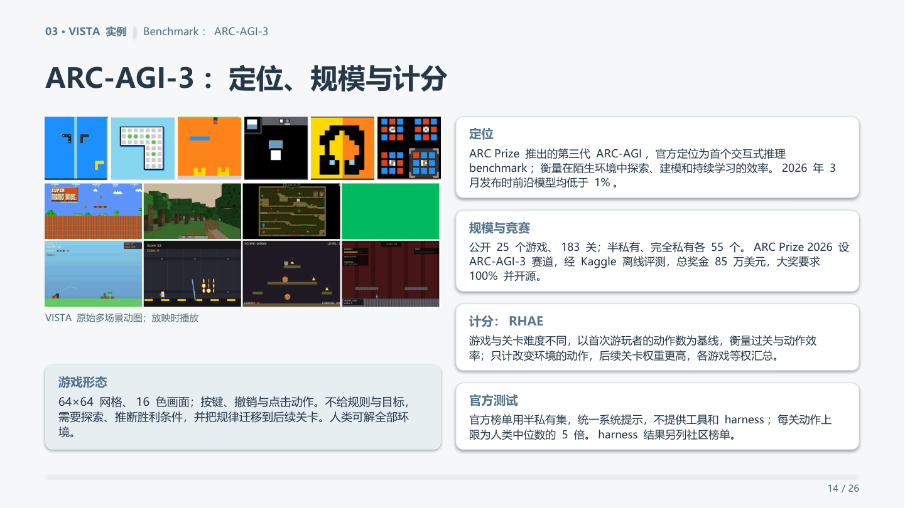

</details>

来源：[S32](#source-s32)、[S20](#source-s20)。

<a id="slide-15"></a>

## 15 · ARC-AGI-3 得分：官方榜单与 harness

03 · VISTA 实例

### 官方榜单 Standard 得分

| 模型阶段 | 模型（括号内为发布日期） | Standard 得分 |
| --- | --- | --- |
| 2026-03 发布时 | Claude Opus 4.6 | 0.5 |
| 2026-03 发布时 | GPT-5.4 | 0.2 |
| 2026-08 前的旗舰 | GPT-5.6 Sol（07-09） | 7.8 |
| 2026-08 前的旗舰 | Claude Opus 5（07-24） | 30.2 |
| 2026-08 之后 | GPT-6 Astra（09-02） | 62.7 |
| 2026-08 之后 | GPT-6.1 Sol（09-29） | 52.7 |
| 2026-08 之后 | Gemini 4 Argon（10-13） | 49.8 |
| 2026-08 之后 | Claude Sonnet 5.5（09-28） | 24.3 |
| 本组主实验模型 | GPT-6 Luna（09-22） | 0.2 |

### VISTA 论文：公开 25 个游戏，RHAE

| 模型 | 基线 RHAE | VISTA RHAE | 基线说明 |
| --- | --- | --- | --- |
| Claude Opus 5.0 | 40.68 | 100.00 | 基线由官方公开集逐局得分计算 |
| GPT-5.6 Sol | 13.33 | 99.00 | 基线为同模型最小 harness |

两者在 VISTA 下通关全部 25 个游戏。本组 Luna 结果见第 24 页。

两组数字不能直接比较：官方榜单为半私有集、无工具；论文与本组实验为公开集、带 harness，effort 与每局动作上限另有设定（论文 2,000 动作）。

[官网人类试玩：ls20 →](https://arcprize.org/tasks/ls20)

<details>
<summary>第 15 页原页预览</summary>

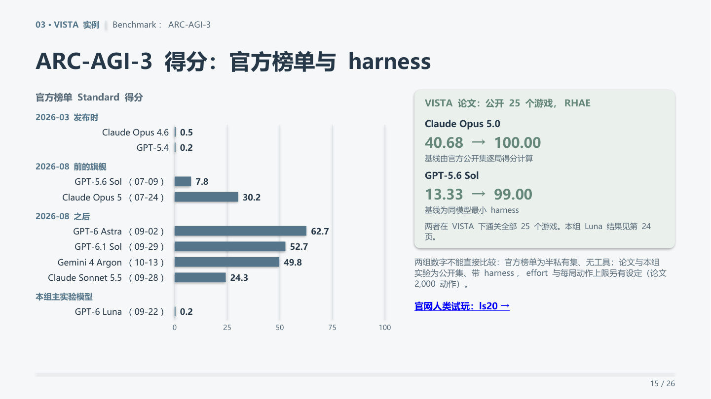

</details>

来源：[S33](#source-s33)、[S20](#source-s20)、[S22](#source-s22)、[S34](#source-s34)。

<a id="slide-16"></a>

## 16 · VISTA：无损视觉记录与 8 个工具

03 · VISTA 实例

VISTA（Qiushi Han、Kaiming He 等，2026）是 ARC-AGI-3 上的执行框架：每帧画面无损保存并整局保留，模型用工具按回合号取回任意历史画面与动作记录，并维护两份笔记。

| 类别 | 工具 | 输入 | 返回 |
| --- | --- | --- | --- |
| 行动 | play | ACTION1–7 或 RESET；点击带坐标 | 元数据 + 本回合最后一帧 |
| 查看 | inspect | 1–16 个视图：回合、帧、区域 | 放大后的历史截图 |
|  | read_pixels | 1–64 个视图，按网格采样 | 颜色符号矩阵 |
| 查历史 | history | events 或 attempts，可限回合区间 | 逐回合动作与结果；各次尝试概况 |
| 长期笔记 | read_guide / write_guide | 全文读写，至多 64 KB | 整局保留的游戏理解 |
| 本关草稿 | read_working / write_working | 全文读写，至多 16 KB | 过关时归档并清空 |

系统提示共 9 行：要求用尽量少的动作完成游戏，维护可修订的游戏理解，行动前说明预期、行动后说明变化。不提供规则与策略；内置工具全部禁用，模型不能读文件或执行代码。只有 play 自动返回画面，其余历史需按回合号主动查询。

<details>
<summary>第 16 页原页预览</summary>

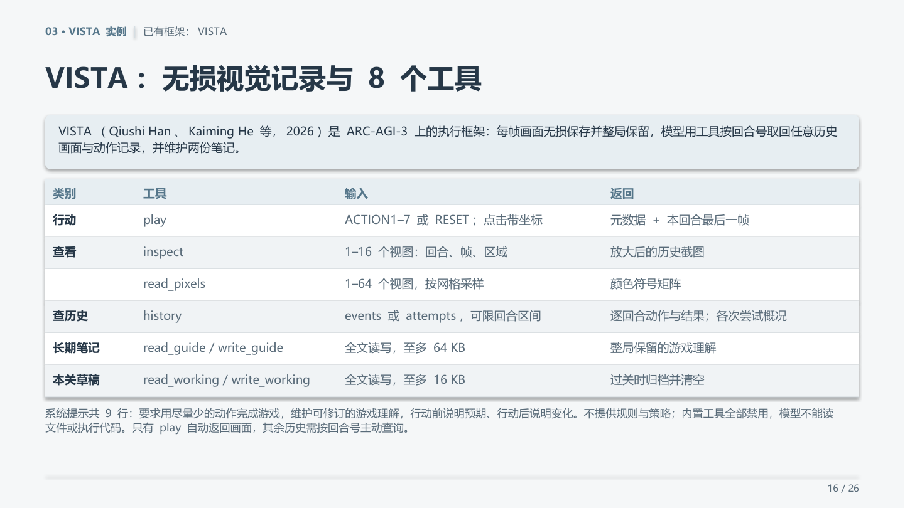

</details>

来源：[S11](#source-s11)、[S20](#source-s20)。

<a id="slide-17"></a>

## 17 · 上下文会压缩，历史和笔记继续保留

03 · VISTA 实例

| 阶段 | 上下文与操作 |
| --- | --- |
| 会话 k | 当前上下文<br>模型调用与工具返回 |
| 检查点 | 更新 WORKING<br>保留已有理解与下一步 |
| 会话 k+1 | 当前观测 + 笔记<br>需要时再检索历史 |

### 整局保留的记录

- 截图与动作记录
- GUIDE：较稳定理解
- WORKING：当前状态

<details>
<summary>第 17 页原页预览</summary>

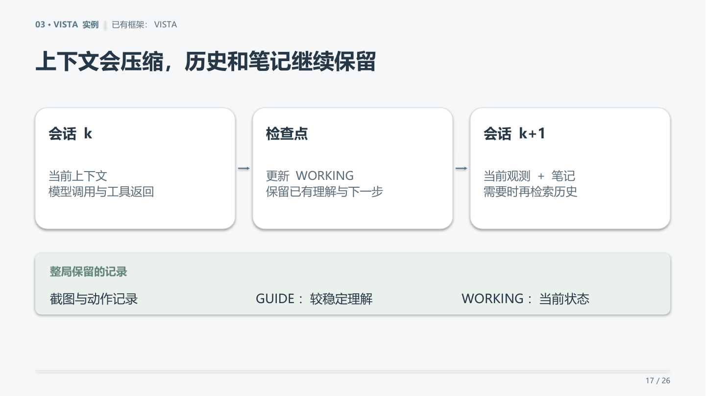

</details>

来源：[S11](#source-s11)、[S12](#source-s12)。

<a id="slide-18"></a>

## 18 · VISTA 的三层：上游能力、trace 接入、经验辅助

03 · VISTA 实例

| 层次 | 功能 | 保存与提供什么 | 读取方与语义 |
| --- | --- | --- | --- |
| 上游 VISTA | 工具、观测与笔记 | play / inspect / history 等工具<br>截图与动作文件；GUIDE / WORKING | 模型运行中按需读取<br>上下文压缩后靠笔记和工具继续 |
| 本地扩展 · trace 接入 | 统一记录与恢复 | 动作、观测、模型与工具调用、笔记版本<br>同一局写成一个 trace<br>OTel 采集，写入 PostgreSQL | 游戏读取：写后可读<br>审计记录：结束时核对<br>恢复：读取已确认前缀 |
| 本地扩展 · 11 项 aids | 经验的整理与使用 | 框架整理观测、检索和尝试统计<br>模型编写规则与交接<br>reset 提供操作入口 | 提示进入下一次模型输入<br>规则由模型编写<br>框架保存来源与修订 |

<details>
<summary>第 18 页原页预览</summary>

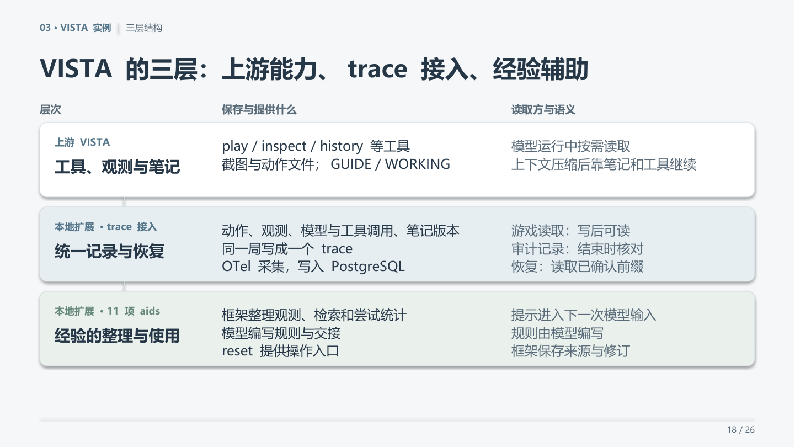

</details>

来源：[S11](#source-s11)、[S12](#source-s12)、[S14](#source-s14)。

<a id="slide-19"></a>

## 19 · VISTA Trace 版：写入与读取路径

03 · VISTA 实例

### 写入路径

```text
VISTA 控制器 → OTel / OTLP → Collector → PostgreSQL
```

| 组件 | 数据或职责 |
| --- | --- |
| VISTA 控制器 | 动作、截图、笔记 |
| OTel / OTLP | 游戏与审计通道 |
| Collector | exporter 适配 |
| PostgreSQL | events + 读取索引 |

### 读取适配层

- 历史截图
- 动作顺序
- 笔记版本

<details>
<summary>第 19 页原页预览</summary>

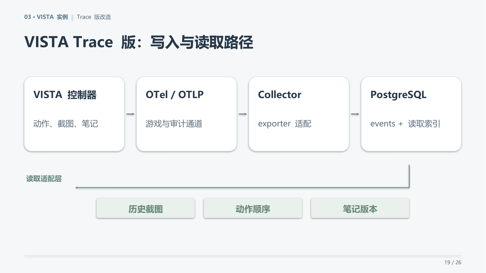

</details>

来源：[S12](#source-s12)、[S13](#source-s13)。

<a id="slide-20"></a>

## 20 · 读屏障与恢复：从已确认的记录继续

03 · VISTA 实例

### 读屏障：工具返回历史前，确认本局相关记录已可读

| 步骤 | 操作 |
| --- | --- |
| ① 追加记录 | 已结束的即时 span；记下待确认 span_id |
| ② 推进导出 | force_flush 游戏数据通道 |
| ③ 确认入库 | 查询待确认 ID，齐全后允许读取 |

读取结果按 agent.seq 恢复顺序 · 按 span_id 去重 · 超时明确报错

### 恢复：从已确认的动作继续同一局

| 步骤 | 操作 |
| --- | --- |
| 选择断点 | 源运行与确认步 |
| 读取状态 | 动作前缀 + 笔记版本 |
| 重放校验 | 逐步比较观测 |
| 继续执行 | 新会话与来源标记 |

恢复点 = 运行 ID + 确认动作序号 + 对应笔记版本 + 恢复来源

读屏障只等待游戏数据通道的即时记录；play 返回的最后一帧来自本次渲染。恢复要求环境确定、配置一致，新运行延续动作计数与剩余预算。

<details>
<summary>第 20 页原页预览</summary>

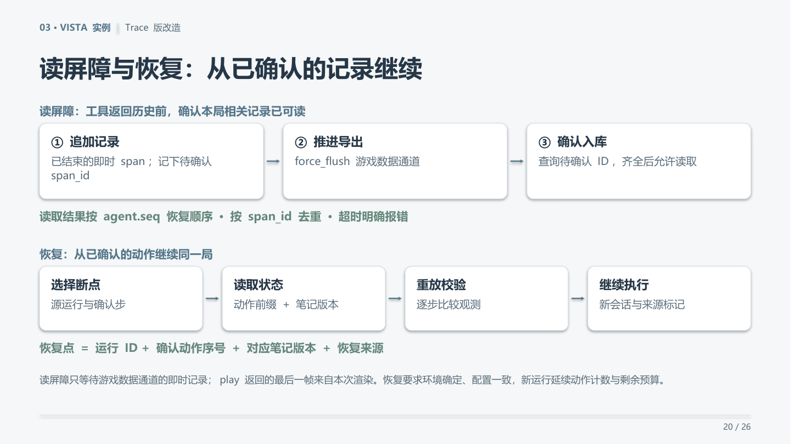

</details>

来源：[S02](#source-s02)、[S12](#source-s12)、[S13](#source-s13)。

<a id="slide-21"></a>

## 21 · 11 项 aids：把执行历史整理成决策提示

03 · VISTA 实例

| 类别 | 辅助 | 对执行历史或当前观测的使用 |
| --- | --- | --- |
| 观测解码 | diff · geometry<br>click · layout | 比较动作前后画面；说明网格坐标；回显点中对象；新关列出对象并提示保存上一关解法 |
| 检索、统计与停滞 | repeat · coverage<br>attempt · stall | 检索相似局面的已试动作与结局；统计点击覆盖、尝试预算与结果条件；画面停滞时要求更新笔记 |
| 记忆与交接 | mechanisms<br>handoff | 记录、修订、撤回带证据回合的规则；交接写明局面、模型、已试、计划与未决问题 |
| 操作入口 | reset | 本关已有动作时允许重开，用于重新验证假设 |

repeat、coverage 和 attempt 统计由确定性代码维护；机制规则由模型编写，框架保存证据、版本与修订。辅助使用运行中可见的信息，游戏源码用于事后核验。得分对应 11 项组合，单项贡献需要消融。

<details>
<summary>第 21 页原页预览</summary>

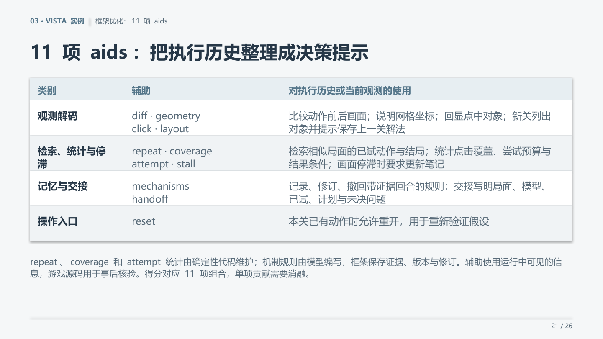

</details>

来源：[S14](#source-s14)。

<a id="slide-22"></a>

## 22 · tu93：同局历史进入下一次决策

03 · VISTA 实例

| 回合或记录 | 内容 |
| --- | --- |
| T155 | 引用本局 T98 的尝试结果 |
| 笔记 | 模型记录已试路线与不同出口 |
| T156 | 执行向下动作，并记录新的观察 |

历史运行回放 · Luna 全开组 tu93 · T145–156 · 29.52 秒，等待时间已压缩

<details>
<summary>第 22 页原页预览</summary>

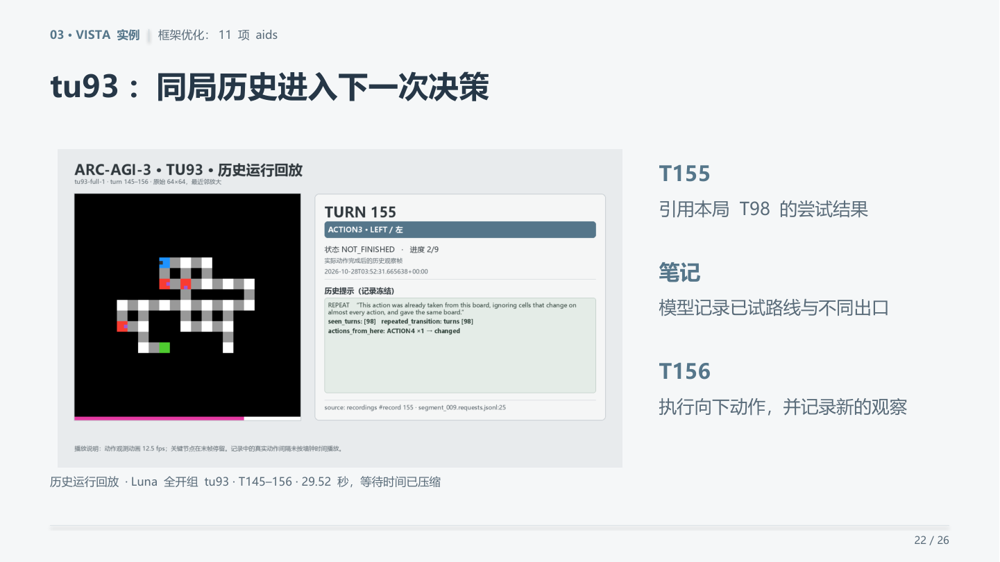

</details>

来源：[S14](#source-s14)、[S15](#source-s15)。

<a id="slide-23"></a>

## 23 · 经验辅助的提升：过关、效率与跨关复用

03 · VISTA 实例

| 游戏或关卡 | VISTA trace | VISTA + aids | 变化 |
| --- | --- | --- | --- |
| tr87 整局 | 5/6 关 · 2,000 动作 | 6/6 关 · 219 动作 | 新增通关，56.00 → 100.00 |
| cd82 整局 | 6/6 关 · 275 动作 | 6/6 关 · 183 动作 | 同样通关，50.93 → 85.83 |
| vc33 整局 | 1/7 关 | 6/7 关 | 多过 5 关，0.01 → 27.99 |
| tn36 整局 | 1/7 关 | 3/7 关 | 多过 2 关，0.05 → 19.86 |
| tu93 整局 | 5/9 关 · 2,000 动作 | 9/9 关 · 927 动作 | 新增通关 |
| sb26 第 7 关 | 645 动作 | 37 动作 | 人类基线 58 |
| lp85 第 4 关 | 205 动作 | 24 动作 | 复用第 3 关规则 |
| s5i5 第 3 关 | 506 动作 | 90 动作 | 利用中间帧与历史反馈 |

### sc25 · 成功条件跨关使用

第 4 关 T386 结果与最后方向关联，写入 GUIDE；第 5 关 T893 修订条目；第 6 关 T1101 主动按左。第 5 关 904 → 452 动作，第 6 关 211 动作通过。

### lp85 · 历史提示选择新控件

T761 依据 repeat 中“同一局面尚未试过 LC”选择该控件；第 3 关的共享路口规则用于第 4 关。

### s5i5 · 比较历史反馈

T1993 比较“yellow-right 11 次无效”与“blue-right 8 次产生变化”，选择后者；中间帧用于识别碰撞回滚。

Luna 25 游戏全量，每组每游戏一局、2,000 动作。表中为整组配置差异；右侧为模型引用历史提示或笔记的记录，单项贡献需要消融。

<details>
<summary>第 23 页原页预览</summary>

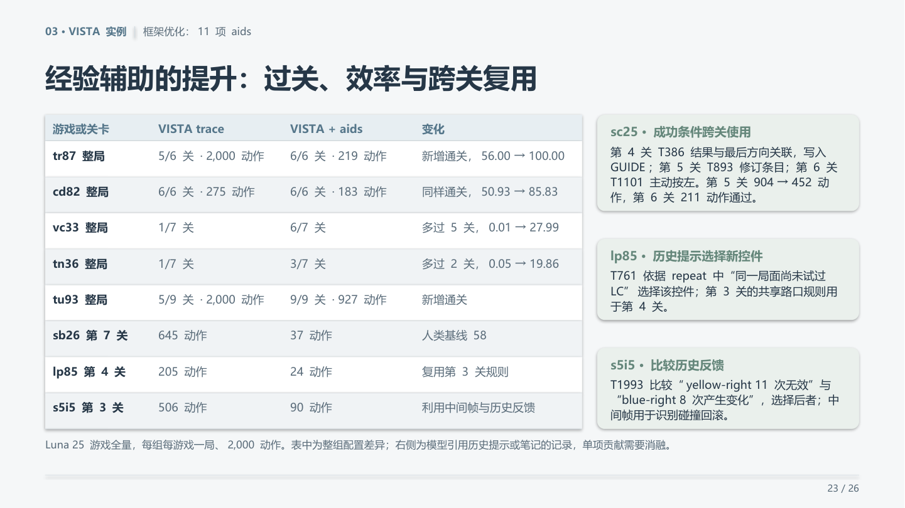

</details>

来源：[S14](#source-s14)、[S25](#source-s25)。

<a id="slide-24"></a>

## 24 · Luna：完整框架与经验辅助的整体效果

03 · VISTA 实例

### 25 游戏平均 RHAE（0–100 分；条长按 0–40 真实比例）

| 配置 | 平均 RHAE |
| --- | --- |
| 官方 Standard max | 约 0.31 |
| VISTA trace | 32.39 |
| VISTA + 11 aids | 37.31 |

| 配置 | 过关 / 183 | 通关 / 25 | 总动作 |
| --- | --- | --- | --- |
| 官方 | 未公布 | 未公布 | 未公布 |
| trace 组 | 108 | 4 | 44,009 |
| aids 组 | 124 | 7 | 39,581 |

同一 Luna 模型、同一公开集。官方为冻结快照，工具与上下文管理不同；trace 组沿用历史两阶段协议，aids 组从第 1 关按整局 2,000 动作运行。差值是整体配置效果；五游戏同预算三轮对照 12.7 → 33.4，15 对中 13 对提高。

<details>
<summary>第 24 页原页预览</summary>

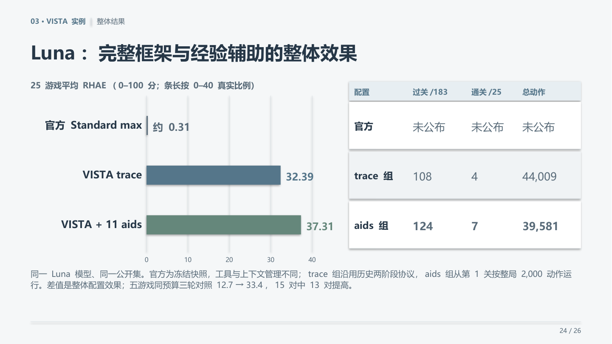

</details>

来源：[S14](#source-s14)、[S22](#source-s22)、[S23](#source-s23)、[S24](#source-s24)、[S25](#source-s25)、[S26](#source-s26)、[S27](#source-s27)。

<a id="slide-25"></a>

## 25 · Trace：是什么、存什么、怎么存、怎么用

收束与衔接

| 问题 | 结论 |
| --- | --- |
| 是什么 | 一次运行的 span 树：父子关系、起止时间、状态与类型，读取时组装为调用树和时间轴 |
| 存什么 | 按 GenAI 约定：结构与时间字段必有，属性与度量可选，消息与工具内容体积大、默认不采集 |
| 怎么存 | 动态属性按访问需求选 JSON 文本或结构化表示；长载荷按引擎选同表、列表副本或外置 |
| 怎么用 | 运行中读回历史、断点恢复、整理成经验提示；事后用于评估、数据准备与失败归因 |

<details>
<summary>第 25 页原页预览</summary>

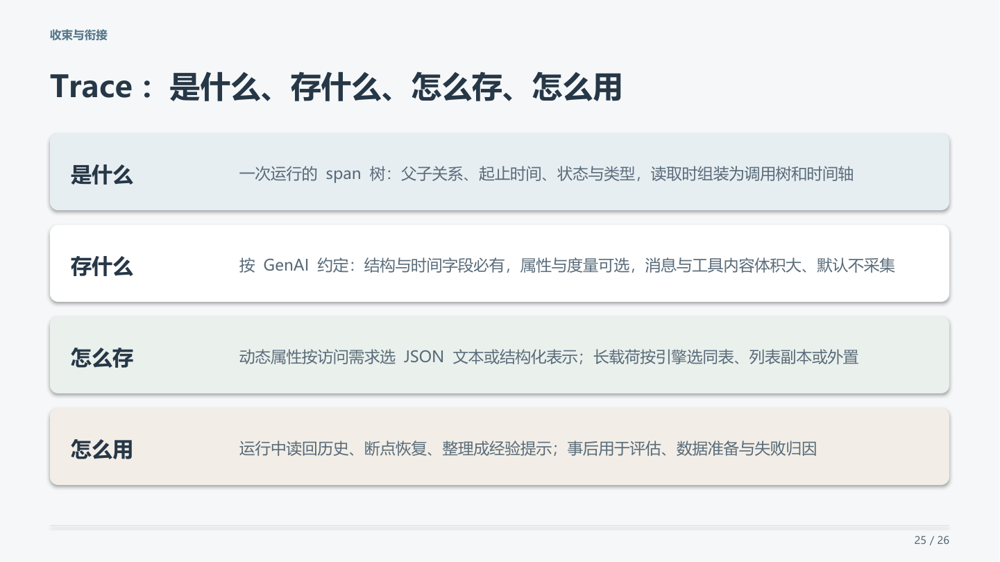

</details>

来源：[S01](#source-s01)、[S31](#source-s31)、[S10](#source-s10)、[S14](#source-s14)、[S18](#source-s18)。

<a id="slide-26"></a>

## 26 · 谢谢

致谢

欢迎提问与交流

下一位分享：基于执行证据的失败归因分析

曹金羽 · Agent Trace 组

<details>
<summary>第 26 页原页预览</summary>


</details>

## 来源与依据

<a id="source-s01"></a>

### S01 · OpenTelemetry：Trace 数据模型

- [公开来源](https://opentelemetry.io/docs/concepts/signals/traces/)
- 范围：规范／概念，2026-11-04 查阅

<a id="source-s11"></a>

### S11 · VISTA 运行时数据流

- 依据类型：项目研究文档或冻结实验数据，未随本 Markdown 发布。
- 范围：上游机制、工具、上下文与交接，版本见文档

<a id="source-s07"></a>

### S07 · OTel、OTLP、Collector 与 Langfuse 学习指南

- 依据类型：项目研究文档或冻结实验数据，未随本 Markdown 发布。
- 范围：本地源码分析快照，版本见文档

<a id="source-s28"></a>

### S28 · LangGraph：持久化与记忆

- [公开来源](https://docs.langchain.com/oss/python/langgraph/persistence)
- [补充来源](https://docs.langchain.com/oss/python/concepts/memory)
- 范围：checkpoint、thread 与跨线程 Store；官方文档，2026-11-07 查阅

<a id="source-s30"></a>

### S30 · OpenAI API：Chat Completions 消息格式

- [公开来源](https://platform.openai.com/docs/api-reference/chat/create)
- 范围：role、content、tool_calls 与 tool_call_id；官方文档，2026-11-08 查阅

<a id="source-s31"></a>

### S31 · OpenTelemetry GenAI 语义约定

- [公开来源](https://github.com/open-telemetry/semantic-conventions-genai/tree/main/docs/gen-ai)
- 范围：Development 状态；execute_tool / invoke_agent 为 INTERNAL，模型调用为 CLIENT；消息内容 Opt-In，可外置并记录 *_ref；2026-11-08 查阅

<a id="source-s17"></a>

### S17 · Trace 记忆生成调研

- 依据类型：项目研究文档或冻结实验数据，未随本 Markdown 发布。
- 范围：方法、信号、输入存储与验证；10-09／10 快照

<a id="source-s29"></a>

### S29 · OpenAI Agents SDK：Sessions

- [公开来源](https://openai.github.io/openai-agents-python/sessions/)
- 范围：会话历史按条目存取；官方文档，2026-11-07 查阅

<a id="source-s08"></a>

### S08 · JSON 存储设计决策

- 依据类型：项目研究文档或冻结实验数据，未随本 Markdown 发布。
- 范围：语料画像、记录约定、分层与设计依据

<a id="source-s10"></a>

### S10 · 长 payload 四布局阶段三简报

- 依据类型：项目研究文档或冻结实验数据，未随本 Markdown 发布。
- 范围：三台主机、修正结果、规模与压缩边界

<a id="source-s09"></a>

### S09 · JSON 表示阶段二正式报告

- 依据类型：项目研究文档或冻结实验数据，未随本 Markdown 发布。
- 范围：openGauss 与 ClickHouse；2026-09-14

<a id="source-s35"></a>

### S35 · openGauss 6.0 JSONB 容器结构与序列化

- [公开来源](https://github.com/opengauss-mirror/openGauss-server/blob/v6.0.0/src/include/utils/jsonb.h)
- [补充来源](https://github.com/opengauss-mirror/openGauss-server/blob/v6.0.0/src/common/backend/utils/adt/jsonb_util.cpp)
- 范围：JsonbContainer、JEntry、键排序与重复键处理；结构示意依据

<a id="source-s04"></a>

### S04 · Langfuse：架构与数据模型

- [公开来源](https://langfuse.com/handbook/product-engineering/architecture)
- [补充来源](https://langfuse.com/docs/observability/data-model)
- 范围：官方产品文档，2026-11-04 查阅

<a id="source-s32"></a>

### S32 · ARC-AGI-3 技术报告与 ARC Prize 2026

- [公开来源](https://arxiv.org/abs/2603.24621)
- [补充来源](https://arcprize.org/competitions/2026/arc-agi-3)
- 范围：RHAE、人类基线、数据集划分、官方测试协议；竞赛奖金与规则；2026-11-08 查阅

<a id="source-s20"></a>

### S20 · ARC-AGI-3 与 VISTA 原始工作

- [公开来源](https://arcprize.org/arc-agi/3)
- [补充来源](https://arxiv.org/abs/2610.02200)
- 范围：原始系统背景；本版不复用旧模型榜单

<a id="source-s33"></a>

### S33 · ARC Prize 官方榜单（ARC-AGI-3）

- [公开来源](https://arcprize.org/leaderboard)
- 范围：Standard 配置得分与发布日期；2026-11-08 查阅，以官网为准

<a id="source-s22"></a>

### S22 · 官方 Standard max 冻结成绩

- 依据类型：项目研究文档或冻结实验数据，未随本 Markdown 发布。
- 范围：25 游戏公开集；冻结快照，非实时榜单

<a id="source-s34"></a>

### S34 · ARC-AGI-3 官方人类试玩：ls20

- [公开来源](https://arcprize.org/tasks/ls20)
- 范围：官网 Public Demo，人类试玩页；2026-11-09 查阅

<a id="source-s12"></a>

### S12 · VISTA trace 存储设计

- 依据类型：项目研究文档或冻结实验数据，未随本 Markdown 发布。
- 范围：本地 trace 版：双通道、读屏障、版本与恢复

<a id="source-s14"></a>

### S14 · VISTA 框架优化综合报告

- 依据类型：项目研究文档或冻结实验数据，未随本 Markdown 发布。
- 范围：已选版本；Luna 全集、多轮对照及 DS／GLM 补充

<a id="source-s13"></a>

### S13 · VISTA trace 版实验报告

- 依据类型：项目研究文档或冻结实验数据，未随本 Markdown 发布。
- 范围：2026-10-16／20 快照；固定回放与模型实验分别解释

<a id="source-s02"></a>

### S02 · OpenTelemetry：Tracing API 与 SDK

- [公开来源](https://opentelemetry.io/docs/specs/otel/trace/api/)
- [补充来源](https://opentelemetry.io/docs/specs/otel/trace/sdk/)
- 范围：span 状态、结束与导出、ForceFlush

<a id="source-s15"></a>

### S15 · tu93 T155–156 冻结摘录

- 依据类型：项目研究文档或冻结实验数据，未随本 Markdown 发布。
- 范围：8 条记录；原日志行号／ID 已核对

<a id="source-s25"></a>

### S25 · Luna 全量与逐关冻结数据

- 依据类型：项目研究文档或冻结实验数据，未随本 Markdown 发布。
- 范围：25 游戏 183 关；整体配置比较

<a id="source-s23"></a>

### S23 · Luna 同预算多轮对照

- 依据类型：项目研究文档或冻结实验数据，未随本 Markdown 发布。
- 范围：5 游戏 × 3 对；统一前 1,000 动作

<a id="source-s24"></a>

### S24 · GLM 25 游戏阶段核定数据

- 依据类型：项目研究文档或冻结实验数据，未随本 Markdown 发布。
- 范围：25 all／14 off；4 对完整双组

<a id="source-s26"></a>

### S26 · GLM 25 游戏附表与回传核验

- 依据类型：项目研究文档或冻结实验数据，未随本 Markdown 发布。
- 范围：核定分数、任务状态与历史背景边界

<a id="source-s27"></a>

### S27 · Luna 五游戏同预算多轮成本冻结摘录

- 依据类型：项目研究文档或冻结实验数据，未随本 Markdown 发布。
- 范围：每组 15 项；前 1,000 动作；累计通过关数 off 53、all 81；token 与有效时长

<a id="source-s18"></a>

### S18 · Trace 后训练数据入门与扩展调研

- 依据类型：项目研究文档或冻结实验数据，未随本 Markdown 发布。
- 范围：用途与数据契约；案头调研，非本地训练结果
